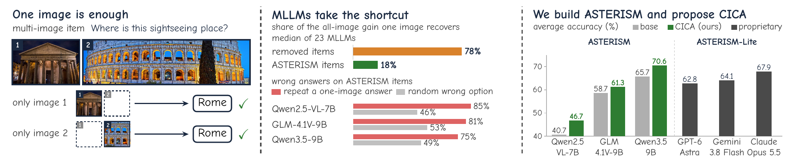

<div align="center">

# ✨ ASTERISM:<br>Do Multimodal LLMs Actually Look at All the Images?

**Chanseul Cho** · **Dongwoo Kim** · **Noori Bae** · **Seungjae Moon** · **Seongsu Lee** · **Youngmin Ro**

Machine Intelligence Lab, University of Seoul

[](https://arxiv.org/pdf/2611.32316)
[](https://arxiv.org/abs/2611.32316)
[](#datasets)
[](#models)

</div>

<p align="center">
  
</p>

## News

- The paper is on [arXiv](https://arxiv.org/abs/2611.32316).
- The datasets and the model weights are on Hugging Face, and the evaluation code and the build scripts are in this repository. The CICA training code will follow soon.

## Overview

Multi-image benchmarks aim to test whether a model combines evidence across images, but many of their items can be answered from a single image. Across about 33k items from 19 public benchmarks, our audit and a two-stage single-image filter find that one image or the question alone settles 24.2% of them, and MLLMs take this single-image shortcut.

- **✨ ASTERISM** keeps the items that need more than one image: 18.7k items under one format, one rule-based scorer and seven task categories, with every corrected label and every rewrite checked by a human reviewer.
- **🌿 CICA** (cross-image credit assignment) extends RLVR. For every token of a response, it compares the policy's likelihood under all images with its likelihood under the best single image, and moves credit toward the tokens that need more than one image. It keeps the data, the reward and the RL objective, and adds no parameters, rollouts or backward pass.

## Video

https://github.com/user-attachments/assets/b212732a-7979-466c-a659-6df47425cae4

## Release

### Datasets

| Dataset | Items | Description | Link |
|---|---:|---|:---:|
| ✨ ASTERISM | 18,696 | Multi-image items from 19 public benchmarks that need more than one image | [🤗 Hugging Face](https://huggingface.co/datasets/seul77/ASTERISM) |
| ✨ ASTERISM-Lite | 400 | Hard subset of ASTERISM, verified one by one | [🤗 Hugging Face](https://huggingface.co/datasets/seul77/ASTERISM-Lite) |
| ✨ ASTERISM-Train | 49,105 | Training items with verifiable answers, with near-duplicates of ASTERISM images removed | [🤗 Hugging Face](https://huggingface.co/datasets/seul77/ASTERISM-Train) |

### Models

| Model | Base model | ASTERISM (base → CICA) | Link |
|---|---|:---:|:---:|
| 🌿 CICA-Qwen2.5-VL-7B | Qwen2.5-VL-7B-Instruct | 40.7 → 46.7 | [🤗 Hugging Face](https://huggingface.co/seul77/CICA-Qwen2.5-VL-7B) |
| 🌿 CICA-GLM-4.1V-9B-Thinking | GLM-4.1V-9B-Thinking | 58.7 → 61.3 | [🤗 Hugging Face](https://huggingface.co/seul77/CICA-GLM-4.1V-9B-Thinking) |
| 🌿 CICA-Qwen3.5-9B | Qwen3.5-9B (thinking mode) | 65.7 → 70.6 | [🤗 Hugging Face](https://huggingface.co/seul77/CICA-Qwen3.5-9B) |
| 🌿 CICA-Qwen3.8-27B | Qwen3.8-27B | – | Coming soon |

ASTERISM scores are macro averages over the seven task categories.

## Code

| Folder | Content |
|---|---|
| [`asterism/`](asterism) | Prompts, the rule-based scorer and the evaluation runner for ASTERISM and ASTERISM-Lite |
| [`build/`](build) | Scripts that assemble the items released as identifiers from the public releases of their sources |
| [`configs/eval/`](configs/eval) | Settings of the paper for evaluating the three CICA models and their base models |
| [`scripts/`](scripts) | `evaluate.py` and `score.py` |

The CICA training code will be released soon.

### Setup

We used two separate environments. The evaluation environment (Python 3.12):

```bash
pip install -r requirements.txt
pip install transformers==5.5.0   # the version we used; it replaces the older Transformers that vLLM 0.18.0 pins
```

The build environment for the items released as identifiers (Python 3.11):

```bash
pip install -r build/requirements.txt
```

With the package versions of `build/requirements.txt`, the build scripts reproduce our image files, and `python -m build.verify` checks the assembled items against our checksums (see [build/README.md](build/README.md)).

### Evaluation

Download [ASTERISM](https://huggingface.co/datasets/seul77/ASTERISM) into `data/ASTERISM/` with `hf download seul77/ASTERISM --repo-type dataset --local-dir data/ASTERISM`. In the build environment, one command downloads the public releases of the seven sources released as identifiers (about 28 GB, no login needed), assembles their items and checks them against our checksums (see [build/README.md](build/README.md)):

```bash
bash build/get_asterism.sh data/ASTERISM
```

Then, in the evaluation environment, generate and score with the settings of each model in `configs/eval/`:

```bash
python scripts/evaluate.py --config configs/eval/cica-qwen3.5-9b.yaml \
    --data data/ASTERISM/data/asterism_full.jsonl --out outputs/cica-qwen3.5-9b
```

The configs of the CICA models load the released checkpoints from Hugging Face, and `--model` evaluates a local copy instead. The configs keep the batch sizes of our runs; a smaller `--batch-size` needs less host memory.

Add `--lite` to evaluate the 400 items of ASTERISM-Lite. `scripts/score.py` scores an existing file of generations.

### ASTERISM-Train

The ASTERISM-Train items released as identifiers are assembled with the scripts in [`build/train/`](build/train) (see [build/train/README.md](build/train/README.md)).

## License

- Code: [Apache License 2.0](LICENSE).
- Our annotations (corrected labels and answer formats, rewritten items, per-item labels): CC BY 4.0, except in the items whose `license` is CC BY-NC-SA 4.0, which carry that license.
- Source items and images keep the license of their benchmark. See [DATA_LICENSE.md](DATA_LICENSE.md).
- Model weights follow the license of their base models.

## Citation

If you find this work useful, please consider citing:

```bibtex
@article{asterism,
  title   = {ASTERISM: Do Multimodal LLMs Actually Look at All the Images?},
  author  = {Cho, Chanseul and Kim, Dongwoo and Bae, Noori and Moon, Seungjae and Lee, Seongsu and Ro, Youngmin},
  journal = {arXiv preprint arXiv:2611.32316},
  year    = {2026}
}
```

## Contact

For questions about the paper, code, datasets or models, please email [chanseul2001@gmail.com](mailto:chanseul2001@gmail.com).
